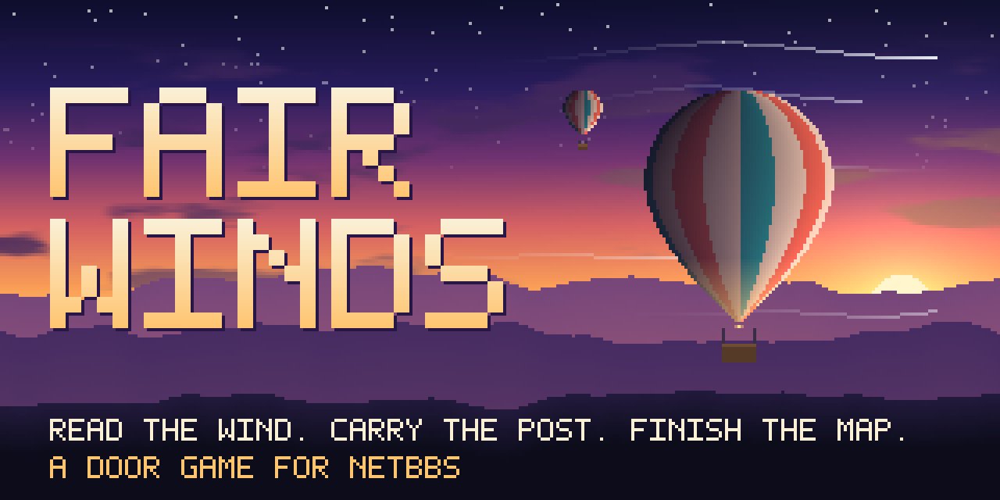

# Fair Winds

*Read the wind. Carry the post. Finish the map.*

A cooperative, turn-based balloon navigation door game for
[NetBBS](https://github.com/Thiesi/NetBBS).

A balloon cannot steer. It can only climb or sink, and every altitude blows a
different way. Each turn you see where the layers within reach would carry you,
and you pick one. You carry mail across a continent that is unique to your BBS,
starts out blank, and is charted by its callers together. Everyone flies the
same weather, and the weather follows the calendar. At the centre of the
continent stands the Gyre, a storm nobody has entered.

There is no combat. Callers chart the map for each other, plant weather
stations that sharpen everyone's forecast, raise mooring masts together and fly
supplies to the stranded.

## Status

**In development.** The first phase is built: the world, the weather, the turn,
and a plain text screen to fly it on. There is no art yet, and most of the game
(the career, the shared world, the seasons) is still to come.

To try the plain flight, run `python fair_winds.py` in a terminal of at least
80 x 24. The game is saved every turn under `data/` beside the file, in one
SQLite file for each world. `python fair_winds.py --backup FOLDER` copies them
safely while callers are playing.

- [Build plan](docs/design.md): scope, phases and slices with acceptance
  criteria.
- [Systems](docs/systems.md): the calendar, the world, the weather, the turn,
  the shared world, presentation and storage.
- [Pitch and mockups](docs/pitch/fair-winds.html): open it in a browser.

## What it will be

Fair Winds will be **one Python file** (`fair_winds.py`) with no dependencies
beyond the standard library. It will need Python 3.11 or newer and a terminal
of at least 80x24. It is built for wide truecolor terminals and stays fully
playable in sixteen colours. The world is one SQLite file that the door manages
itself.

Play is paced by the world's calendar, never by the call. A flight is saved
every turn, so a caller can leave at any moment and carry on later.

## Development

See [AGENTS.md](AGENTS.md).

## License

BSD 2-Clause. See [LICENSE](LICENSE).
